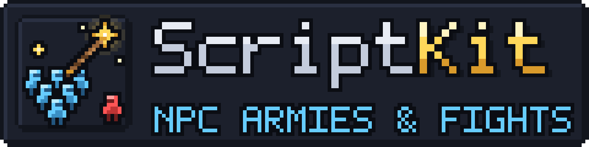

# ScriptKit



**Film a Minecraft battle without recruiting thirty friends.**

ScriptKit is a free, open-source (MIT) Fabric mod for scripted SMPs and video creators. It gives you armies of player-like NPCs that fight on their own, wait for your cue, and can be arranged from far away with one stick.

| | |
|---|---|
| Version | 1.0.1 |
| Minecraft | 1.21.11 |
| Loader | Fabric Loader 0.20.1 or newer |
| Required mod | [Fabric API](https://modrinth.com/mod/fabric-api) |
| Java | 21 |
| Install on | the server **and** every player's client |

## Contents

- [Install](#install) and [where everything lives](#folder-map)
- [Quick start](#quick-start-your-first-scene)
- [The Command Stick](#the-command-stick)
- [Commands](#commands)
- [Menu, tutorial and keybinds](#menu-tutorial-and-keybinds)
- [Combat, difficulty and kits](#combat-difficulty-and-kits)
- [Configuration files](#configuration-files)
- [Troubleshooting](#troubleshooting) and [feedback](#feedback-and-bugs)
- [Building from source](#building-from-source)

## Features

- **Player-like NPCs** with random or chosen skins and generated names like `PingAbuse`. They drop their gear on death like a real player.
- **Armies and teams**: spawn armies in a circle, grid, line, column, wedge or scatter. Players with no team are fair game for every army.
- **Combat AI**: melee, bows, shields, critical hits, strafing, bunny hopping, mining and building to reach enemies, and regrouping after fights.
- **Difficulty presets** (easy, normal, hard, nightmare) per army, changeable mid-fight.
- **Kits**: save gear sets and hand them to an army, one NPC, or yourself.
- **Command Stick**: select an army from far away, change its formation with left-click, see a ghost preview, and place it with right-click.
- **In-game menu** (K), rebindable keys and combos, and a nine-lesson tutorial.
- **Server friendly**: operator-only, server-validated and rate-limited, plain JSON config.

## Install

1. Install the [Fabric Loader](https://fabricmc.net/use/installer/) for Minecraft 1.21.11 (or create a Fabric 1.21.11 profile in your launcher of choice).
2. Download [Fabric API](https://modrinth.com/mod/fabric-api) for 1.21.11.
3. Download `scriptkit-1.0.1.jar` from Modrinth (search for ScriptKit) or the [GitHub releases](https://github.com/Azed1239/scriptkit/releases).
4. Put **both jars** (Fabric API and ScriptKit) in the `mods` folder, on the server and on each player's client. See the folder map below.
5. Start the game. On first launch ScriptKit creates its config files.

ScriptKit adds custom entities and an item, so a player without the mod cannot join a server that has it.

### Folder map

Paths are for Windows. `%appdata%` is `C:\Users\<you>\AppData\Roaming`.

| What | Singleplayer / client | Dedicated server |
|---|---|---|
| Put the mod jars here | `%appdata%\.minecraft\mods\` | `<server folder>\mods\` |
| Server config (`config.json`, `combat.json`, `kits.json`) | `%appdata%\.minecraft\config\scriptkit\` | `<server folder>\config\scriptkit\` |
| Your personal keys and tutorial progress (`keybinds.json`, `tutorial.json`) | `%appdata%\.minecraft\config\scriptkit\` | each player's own `.minecraft\config\scriptkit\` |
| NPC block-change log (for `/army cleanup`) | `%appdata%\.minecraft\saves\<World>\data\scriptkit_block_changes.dat` | `<server folder>\<world>\data\scriptkit_block_changes.dat` |
| Logs (attach these to bug reports) | `%appdata%\.minecraft\logs\latest.log` | `<server folder>\logs\latest.log` |
| Crash reports | `%appdata%\.minecraft\crash-reports\` | `<server folder>\crash-reports\` |
| Screenshots (F2) | `%appdata%\.minecraft\screenshots\` | - |

Quick ways to open them: press `Win + R`, type `%appdata%\.minecraft` and press Enter. In Minecraft, **Options > Resource Packs > Open Pack Folder** opens `.minecraft\resourcepacks`; go up one folder and you are in `.minecraft`, where `mods`, `config`, `logs` and `saves` are.

Using another launcher? The same folders live inside the instance folder: Modrinth App (`...\ModrinthApp\profiles\<name>\`), Prism Launcher (`...\PrismLauncher\instances\<name>\minecraft\`), CurseForge (`...\curseforge\minecraft\Instances\<name>\`). Right-click the instance and choose "Open folder" to find it.

The config files are created the first time the game or server runs, and re-read when the server starts (or when you run `/scriptkit reload`).

### Permissions

All ScriptKit commands, the Command Stick, and menu edits need operator permission (gamemaster, level 2). Make yourself an operator on a server with `/op <name>`. Singleplayer worlds need cheats on.

## Quick start: your first scene

1. `/scriptkit stick` gives you the Command Stick.
2. Spawn two armies. `/army spawn 12 red none steve wedge`, then step aside and `/army spawn 12 blue none alex line`.
3. Right-click any NPC with the stick to select its army.
4. Left-click to cycle the formation, aim at the ground to see the ghost preview, and right-click to place the army.
5. Do the same for the other army.
6. Press **G** (or `/army toggle all`) and both armies fight.

Prefer to be walked through it? Press **K** and open the **Tutorial** tab. It teaches each command with Copy and Run buttons.

Tip: if you want to pose and film an army without it moving, run `/army toggle all off` first. New armies then spawn frozen until you toggle all back on.

## The Command Stick

`/scriptkit stick` (operator) gives you the stick. It is also in the creative **Tools** tab.

| Action | Result |
|---|---|
| Right-click an NPC (up to 96 blocks away) | Select its whole army. It is outlined and frozen. |
| Left-click | Cycle the formation: circle, grid, line, column, wedge, scatter. |
| Shift + left-click | Cycle the spacing: 1, 1.5, 2, 3, 4 blocks. |
| Aim at the ground | Ghost preview of the army where it will stand, facing the way you look. Slots with no ground are outlined red. |
| Right-click the ground | Place the army. The new spot is where it regroups after a fight. |
| Shift + right-click | Deselect. |
| **G** | Start the fight. |

Left-clicking never hits or mines anything while you hold the stick. Until you pick a formation, the army keeps the shape it has. The formation turns with where you look, and each NPC keeps the same slot while you cycle. An NPC with no team is selected on its own. The ghosts exist only on your screen and are never sent to the server.

## Commands

All need operator permission.

### Armies

| Command | What it does |
|---|---|
| `/army spawn <count> <team> [kit] [skin] [formation] [difficulty]` | Spawn NPCs around you (up to `maxArmySize`, default 100). Formation: `circle` (default), `grid`, `line`, `column`, `wedge`, `scatter`. |
| `/army formation <team\|all> <shape> [spacing]` | Re-arrange a team in place, facing the way you look (spacing 0.8 to 8, default 1.5). |
| `/army toggle <team\|all> [on\|off]` | Turn AI on or off. `all` also decides how armies spawned afterwards start: after `toggle all off` they spawn frozen. |
| `/army list` | Teams, sizes, AI state and difficulty. |
| `/army remove <team\|all>` | Remove NPCs. |
| `/army team <selector> <team>` | Move NPCs to a team, e.g. `/army team @e[type=scriptkit:npc,distance=..10] red`. |
| `/army difficulty` | List the presets. |
| `/army difficulty <team\|all> <level>` | Set an army's difficulty. |
| `/army kit <team\|all> <kit>` | Give an army a kit. |
| `/army blocks [on\|off]` | NPC mining and building on or off. |
| `/army cleanup` | Put back every block NPCs mined or placed. |

### Single NPCs

| Command | What it does |
|---|---|
| `/npc spawn <name> [skin] [team] [kit]` | Spawn one NPC at your position. |
| `/npc remove <name\|all>` | Remove NPCs. |
| `/npc list` | List NPCs. |
| `/npc kit <name\|all> <kit>` | Change gear. |
| `/npc difficulty <name\|all> <level>` | Set difficulty. |
| `/npc info <name>` | Why is this NPC (not) fighting? Shows its AI state, team, target and why nearby entities are or aren't enemies. |

### Everything else

| Command | What it does |
|---|---|
| `/scriptkit stick [players]` | Give the Command Stick. |
| `/scriptkit kit <kit> [players]` | Put a kit's items in your inventory. |
| `/scriptkit menu` | Open the menu (same as **K**). |
| `/scriptkit tutorial` or `/sktutorial` | Open the tutorial. |
| `/scriptkit reload` | Reload configs and tell clients to re-read their keybinds. |

Teams are normal Minecraft scoreboard teams. The mod gives new ones a stable color (change it with `/team modify <team> color <color>`). `all` cannot be a team name.

## Menu, tutorial and keybinds

Press **K** (rebindable in Options > Controls > ScriptKit) or run `/scriptkit menu`. Non-operators can look but not change anything.

| Tab | Use it to |
|---|---|
| **Difficulty** | Edit presets with sliders, save copies, set the default, apply to an army. |
| **Kits** | Build kits slot by slot with an item picker and enchantments, and give them to an army, an NPC or yourself. |
| **Team** | Join a team, create one, or go neutral. On a team, that army leaves you alone; neutral players are attacked by every army. |
| **Keybinds** | Edit key combos without a text editor. |
| **Tutorial** | Nine lessons with the real commands, Copy and Run buttons, and tick marks. |

The first time you join a world as an operator, a small pop-up offers the tutorial. It never pauses the game.

### Keybinds

| Key | Default | Does |
|---|---|---|
| Toggle all armies | **G** | Flip AI for every NPC. |
| Toggle team 1 / 2 / 3 | unbound | Same, for the teams in `teamSlots`. |

Combos go in `config/scriptkit/keybinds.json` (on your client):

```json
{
  "teamSlots": ["red", "blue", "green"],
  "bindings": [
    { "action": "toggleTeam", "team": "red", "keys": ["LEFT_CONTROL", "R"] },
    { "action": "disableAll", "keys": ["CTRL", "SHIFT", "1"] }
  ]
}
```

- **Actions:** `toggleAll`, `toggleTeam`, `enableAll`, `disableAll`, `enableTeam`, `disableTeam`. Team actions need a `"team"`.
- **Keys:** `A`-`Z`, `0`-`9`, `F1`-`F12`, `SPACE`, `TAB`, arrows and so on. `CTRL`, `SHIFT` and `ALT` accept either side.
- Matching is exact: Ctrl+R fires only for Ctrl+R. Nothing fires while chat or a screen is open, and holding a combo does not repeat.
- The server answers on the action bar, for example `Red army: ON (30 NPCs)`. It ignores more than 4 keybind packets per second per player.
- After editing, run `/scriptkit reload`. On a dedicated server each player edits their own file.

## Combat, difficulty and kits

With AI on, each NPC:

- **Targets** the nearest living entity on a different team within `detectionRange`, including players with no team. Teammates and creative players are never targeted. To fight for an army, join its team; to fight them all, stay neutral.
- **Fights like a player.** It chases with sprint, swings at the weapon's real attack speed, circle-strafes, lands jump crits, and keeps a shield up. Archers keep 10 to 15 blocks away, lead moving targets and back off when pressed.
- **Bunny hops.** About half of all NPCs (`bunnyHopChance`) hop while sprinting at an enemy, so a group looks like a mix.
- **Regroups.** With no target left it walks back to its formation spot.
- **Mines and builds** to reach a target it can't get to: it pillars up, tunnels and staircases down. Chests, beds, unbreakable blocks and anything harder than `maxBreakHardness` are never broken. Every change is logged so `/army cleanup` can undo it.
- **Is hunted by hostile mobs.** Zombies, skeletons, creepers and the like attack NPCs. NPCs ignore mobs by default (`npcsFightHostileMobs`).
- **Idles** in place when there's nothing to do, so formations hold.

With AI off, an NPC is completely frozen: it runs nothing and doesn't turn toward players. The state is saved with the NPC.

### Difficulty

| | easy | normal | hard | nightmare |
|---|---|---|---|---|
| Damage | x0.6 | x1.0 | x1.6 | x3.0 |
| Health | x0.8 | x1.0 | x1.3 | x2.0 |
| Melee accuracy | 45% | 75% | 90% | 100% |
| Archer accuracy | 50% | 80% | 92% | 100% |
| Jump-crit chance | 10% | 35% | 50% | 70% |
| Swing rate | x0.8 | x1.0 | x1.15 | x1.3 |
| Speed | x1.0 | x1.0 | x1.05 | x1.1 |
| Shield skill | 30% | 70% | 90% | 100% |
| Reaction | x0.5 | x1.0 | x1.5 | x2.5 |
| Detection range | x0.8 | x1.0 | x1.2 | x1.5 |

Edit presets in the Difficulty tab or in `combat.json`; add your own under any name. Against a player in full `god`-kit netherite, a normal NPC does only a few points of damage, so use `hard` or `nightmare` for real danger.

### Kits

Built in: `knight` (iron, sword, shield), `archer` (leather, bow), `god` (maxed netherite with sword and shield) and `none`. Make your own in the Kits tab, or in `config/scriptkit/kits.json`:

```json
"mainhand": { "id": "minecraft:netherite_sword", "enchantments": { "minecraft:sharpness": 5, "minecraft:fire_aspect": 2 } }
```

Slots: `head`, `chest`, `legs`, `feet`, `mainhand`, `offhand`. Omitted slots are empty. NPCs drop all their gear when they die.

### Names and skins

Armies get gamer-tag names (`PingAbuse`, `BanThis`, `xXDarkLordXx`). Set `nameStyle` to `numbered` in `config.json` for `red-1`, `red-2`. NPCs without a chosen skin get a random built-in skin, stable across restarts. Give `/army spawn` a skin to override it for the whole army, or list usernames in `skinPool` to pick from real accounts.

## Configuration files

All in `config/scriptkit/`, JSON, created on first run, re-read on server start or `/scriptkit reload`.

### `config.json`

| Option | Default | Meaning |
|---|---|---|
| `maxArmySize` | 100 | Largest army one command can spawn. |
| `friendlyFire` | false | Applied to teams when they are created. |
| `defaultFormation` | circle | Formation when `/army spawn` has none. |
| `nameStyle` | generated | `generated` or `numbered`. |
| `skinPool` | (empty) | Usernames to pick skins from. |

### `combat.json`

| Option | Default | Meaning |
|---|---|---|
| `detectionRange` | 32 | Blocks within which NPCs notice enemies. |
| `retargetIntervalTicks` | 20 | How often each NPC re-picks its target. |
| `strafe` | true | Circle-strafe in melee. |
| `block` | true | Use offhand shields. |
| `hostileMobsAttackNpcs` | true | Hostile mobs attack NPCs. |
| `npcsFightHostileMobs` | false | NPCs fight mobs after players and enemy NPCs. |
| `regroupAfterFight` | true | Walk back to the formation spot when there is no target. |
| `bunnyHopChance` | 0.5 | Fraction of NPCs that bunny hop. |
| `targetTeamlessPlayers` | true | Players with no team are attacked by every army. |
| `targetCreativePlayers` | false | Also chase creative players. |
| `defaultDifficulty` | normal | Difficulty for NPCs without one. |
| `difficulties` | (4 presets) | The presets above. |
| `damageMultiplier` | 1.0 | Scales all NPC damage. Lower means longer fights. |
| `npcsCanHurtPlayers` | true | If false, NPCs never target players. |
| `playerFriendlyFire` | true | Players can damage NPCs on their own team. |
| `dropKitOnDeath` | true | Drop gear on death. |
| `deathMessages` | true | Player-style death messages in chat. |
| `leaveMessages` | true | "left the game" after a death. |
| `leaveMessageOnRemove` | false | Also for `/npc remove` and `/army remove`. |
| `allowBlockBreaking` | true | Stuck NPCs may mine. |
| `allowBlockPlacing` | true | Stuck NPCs may pillar up. |
| `maxBreakHardness` | 5.0 | Hardest block they may break (obsidian is safe). |
| `pillarBlock` | `minecraft:cobblestone` | Block used for pillaring. |
| `dropMinedBlocks` | false | Mined blocks drop items. |

### `kits.json`, `keybinds.json`, `tutorial.json`

`kits.json` holds your kits (see above). `keybinds.json` and `tutorial.json` are per player and live on the client.

## Troubleshooting

| Problem | Try this |
|---|---|
| Can't join, or kicked on join | The player needs the same ScriptKit (and Fabric API) as the server. |
| "Unknown command" or nothing happens | You are not an operator (`/op <name>`), or the mod isn't on the server. |
| Menu, G key or ghost preview missing | ScriptKit must be on your client too. Check the Controls screen for a ScriptKit section. |
| Armies don't fight | Check `/army list` (is AI on?) and `/npc info <name>`. Two armies on the same team never fight each other. Enemies beyond `detectionRange` are ignored. |
| New armies stand still | `/army toggle all off` was used. Run `/army toggle all on` or press G. |
| NPCs dug holes or built pillars | `/army cleanup`, then `/army blocks off` to stop it. |
| Game crashes on start | Check Fabric API is installed and the versions match (1.21.11). Attach `latest.log` to an issue. |

## Feedback and bugs

Found a bug or have an idea? [Open an issue](https://github.com/Azed1239/scriptkit/issues/new/choose). For a bug, include what you typed or clicked, the ScriptKit version, singleplayer or server, and the relevant part of `logs/latest.log` (or the crash report). For a feature request, describe the scene you are trying to make.

**Known limitations**

- Minecraft 1.21.11 only.
- Armies and fights only: no scripted scenes (timed movement, dialogue, recording) yet.
- Tested in singleplayer and on a dev server, not yet on large public servers. Hundreds of NPCs fighting at once, and NPC mining and building, are the likeliest places to find problems.

## Building from source

You need JDK 25 to run Gradle (the mod itself compiles for Java 21).

```
./gradlew build        # jar in build/libs/
./gradlew runServer    # dev server (accept the EULA in run/eula.txt first)
./gradlew runClient    # dev client
./gradlew test         # unit tests
```

Developer flags: `-Dscriptkit.debug=true` adds dev-only simulate and snapshot commands on the server; `-Dscriptkit.debug.ui=true` runs a menu smoke test with screenshots; `-Dscriptkit.debug.ghost=true` runs an in-world ghost-preview smoke test.

Code layout: `dev.scriptkit` has `npc`, `ai`, `command`, `network`, `item`, `platform` (main source set) and `client` (client source set). Version-specific code (rendering, payloads, registries) sits in thin wrappers so a port to a newer Minecraft stays small.

## License

MIT, see [LICENSE](LICENSE). Not affiliated with Mojang or Microsoft.
